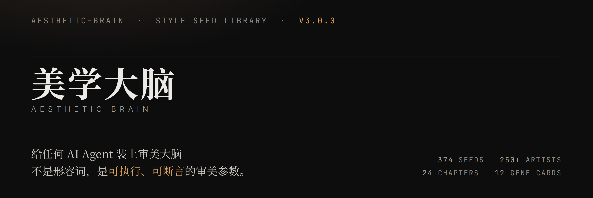

<p align="right">
  <a href="README.md"></a>
  <a href="README.zh-CN.md"></a>
</p>



<p align="center">
  <a href="https://github.com/hhx465453939/agent-taste-seed-system/actions/workflows/ci.yml"></a>
  <a href="LICENSE"></a>
  <a href="LICENSE"></a>
  <a href="CITATION.cff"></a>
</p>

### ▶︎ [**Live gallery — 12 real rendered pages: taste.hxalex.com**](https://taste.hxalex.com)

A portable **aesthetic operating system** and **art-style seed library** for AI agents — Claude Code, Codex, OpenClaw, pi, workbuddy, codebuddy, Trae, Qoder, hermas, or anything else that can read files.

It fixes the one thing nearly every model gets wrong: the **default AI aesthetic** — centred headline, three evenly spaced cards, purple gradient, generic rounded corners.

**Instead of adjectives, it hands the agent 250+ artists and style movements**, distilled into five gene loci — **colour × light × brushwork × composition × emotion** — and then into executable parameters (CSS variables, prompt keywords, layout rules) plus pixel-level assertions that make taste regression-testable.

<sub>**v3.0.0** · 2026-10-24 · formerly `agent-taste-seed-system` · [repository](https://github.com/hhx465453939/agent-taste-seed-system) · [license](LICENSE): text **CC BY 4.0** / code **MIT** / fonts **OFL–Apache** — commercial use allowed, no NonCommercial clause.<br>Source: *Encyclopedia of Art Styles* (24 chapters, 250+ artists) reworked into an executable decision system · gallery source: [`demos/index.html`](demos/index.html)</sub>

<p align="center">
  <a href="https://taste.hxalex.com"></a>
  <a href="https://taste.hxalex.com"></a>
  <a href="https://taste.hxalex.com"></a>
  <a href="https://taste.hxalex.com"></a>
</p>

---

## 📍 Deployment rule (read this before picking your agent)

> **The seed library must be installed inside the agent's own skill directory (`<skill root>/taste/references/`) — never at a workspace root, and never in an ordinary subdirectory of a workspace.**

Why: many agent hosts run **automatic workspace cleanup** on the machine — periodically moving files under the workspace into an archive path, or deleting them outright. If the seed library lands in an ordinary workspace directory, every path hard-coded into the injection prompt **breaks permanently and silently**: the agent "looks up the library" on every task, finds nothing every time, and degrades back to the default AI aesthetic without ever raising an error.

Putting it inside `skills/` works because `skills/` means "this agent's capabilities", and cleanup policies target personas and working areas rather than capability directories. **Separate by semantics, not by whether a directory happens to be write-protected.**

| Agent | Skill root | Seed library location |
|---|---|---|
| Claude Code | `~/.claude/skills/` | `~/.claude/skills/taste/references/art-seeds.md` |
| Codex | `~/.codex/skills/` | `~/.codex/skills/taste/references/art-seeds.md` |
| OpenClaw | `<workspace>/skills/` | `<workspace>/skills/taste/references/art-seeds.md` |
| pi / Kimi | `~/.agents/skills/` (a symlink to `~/.claude/skills` on this machine) | `<agents skill root>/taste/references/art-seeds.md` |
| Agents with no skill mechanism | the repo clone (which **must not** sit inside any workspace) | `<clone root>/references/art-seeds.md` |

**Path convention**: documents inside a skill always use paths **relative to the skill root** (`references/art-seeds.md`, `references/moods/01-…`); only global rule files outside the skill use absolute paths.

---

## 🚀 One-shot install: copy an instruction, send it to your agent, let it install itself

> **How to use (10 seconds)**: find your agent below → click the copy icon at the top-right of the code block → paste it to that agent → wait for it to install and report back. Each instruction is self-contained: repo URL, steps, reporting requirements, and an idempotency guard. The agent should need no further questions.

### 🤖 Claude Code

```text
Install "Aesthetic Brain" (aesthetic-brain) for Claude Code on this machine.

Repository: https://github.com/hhx465453939/agent-taste-seed-system

Steps:
1. git clone https://github.com/hhx465453939/agent-taste-seed-system.git ~/agent-taste-seed-system
   (if the directory already exists, cd into it and run git pull)
2. bash ~/agent-taste-seed-system/deploy/install-claude-skill.sh
   (installs the taste skill into ~/.claude/skills/taste/ with all four seed layers:
    full library / mood files / code-gene cards / chapter files. The script backs up any previous seed library.)
3. Append the thin-injection section to the end of ~/.claude/CLAUDE.md — take it verbatim from
   ~/agent-taste-seed-system/deploy/claude-code.md (the section headed with the "Taste Seed System" heading).
   If a section with the same heading already exists, skip it; do not append twice.
4. Report back: the skill install path and file list, what you appended to CLAUDE.md, and how I can verify it works.

Notes:
- Do not modify anything under references/ in the repo; that is the seed library itself.
- The seed library must live inside the skill (~/.claude/skills/taste/references/). Never flatten it into
  any workspace directory — workspace auto-cleanup moves files away and every hard-coded path breaks silently.
```

### 🦞 OpenClaw

```text
Install "Aesthetic Brain" (aesthetic-brain) for this OpenClaw workspace.

Repository: https://github.com/hhx465453939/agent-taste-seed-system

Steps:
1. git clone https://github.com/hhx465453939/agent-taste-seed-system.git ~/agent-taste-seed-system
   (run git pull if it already exists)
2. Read ~/agent-taste-seed-system/deploy/openclaw.md first, then follow it:
   - install the seed library inside the skill: `<workspace>/skills/taste/references/`
     (copy the whole four-layer library: `cp -R references/. <workspace>/skills/taste/references/`)
   - keep the decision layer next to the skill (`TASTE.md` and `SKILL.md` go into `<workspace>/skills/taste/`)
   - do NOT flatten it to the workspace root or workspace/taste/ — workspace auto-cleanup will move it away
     and every reference breaks permanently
   - if you already installed the old layout (workspace-root taste/), follow the "migrating from the old layout"
     section: back up the flavour log first, then overwrite, then clean up the old location
   - merge the injection prompt from AGENT-INJECTION.md into that workspace's AGENTS.md or SOUL.md
     (skip if a section with the same heading already exists)
3. Report back: file locations, injection point, and how to verify it (e.g. ask it for a poster and check
   whether it states an emotion keyword first).
```

### 🧠 Codex

```text
Install "Aesthetic Brain" (aesthetic-brain) for Codex on this machine.

Repository: https://github.com/hhx465453939/agent-taste-seed-system

Steps:
1. git clone https://github.com/hhx465453939/agent-taste-seed-system.git ~/agent-taste-seed-system
   (run git pull if it already exists)
2. Read ~/agent-taste-seed-system/deploy/generic-agents.md and follow "Case A: the agent has a skill mechanism":
   install the four-layer seed library into Codex's skill directory `~/.codex/skills/taste/references/`
   (`mkdir -p` + `cp -R references/.`), then append the thin-injection section from that document to the end
   of the global rule file (e.g. ~/.codex/AGENTS.md). Skip if a section with the same heading already exists.
3. Report back: where the seed library landed, which rule file you modified, how many lines you appended,
   and how you will run the workflow (emotion → genes → parameters → self-check → log) on the next visual task.
```

### 🧩 Trae / Qoder / pi / workbuddy / codebuddy / hermas and other agents (generic)

```text
Install "Aesthetic Brain" for this agent.

Repository: https://github.com/hhx465453939/agent-taste-seed-system

Steps:
1. git clone https://github.com/hhx465453939/agent-taste-seed-system.git ~/agent-taste-seed-system
   (run git pull if it already exists)
2. Read the repo's README.md and deploy/generic-agents.md, then work out your own rule-loading mechanism
   and deploy accordingly:
   - skill mechanism → install the seed library inside your own skill directory
     (`<your skill root>/taste/references/`); use paths relative to the skill root in the injection text
   - global rule file only, no skill mechanism → keep the seed library in the repo clone
     (that directory must not sit inside any workspace); use its absolute path in the injection text
   - system prompt / knowledge base only → merge the injection prompt from AGENT-INJECTION.md verbatim,
     and keep TASTE.md and references/art-seeds.md as readable knowledge files
     (if you can install a directory, install the whole references/ so all four layers are available)
3. Self-check after installing: restate in one sentence your workflow for visual tasks
   (locate emotion → look up 1 primary + 1 accent gene → translate the five genes into parameters →
    one-sentence self-check → log the pairing after delivery)
4. Report back: deployment mode, seed library location, and that self-check sentence.

Do not: flatten the seed library into the agent workspace root or an ordinary workspace subdirectory
(workspace auto-cleanup moves it away and every reference breaks permanently).
```

### 🌐 Universal (any agent, including web chatbots)

```text
From now on you are equipped with "Aesthetic Brain". Visit
https://github.com/hhx465453939/agent-taste-seed-system and read README.md, TASTE.md, and
AGENT-INJECTION.md (load files from references/ on demand — do not load the whole library into context).

For every task that involves aesthetics or visual presentation (long images / posters / decks / charts /
illustrations / UI / covers / colour schemes / text-to-image prompts / Word and document layout, and also
aesthetic questions about everyday life and social relationships), you must:
first locate the emotion (what should the reader feel — one word) → look up 1 primary + 1 accent style gene
in the library → translate the five genes (colour / light / brushwork / composition / emotion) into concrete
parameters → run a one-sentence self-check (what is this piece's genome?) → log the pairing after delivery.

Do not output the default AI aesthetic (generic cards / blue-purple gradients). One primary gene per piece;
mixing is allowed only one layer deep.
```

> 💡 The universal version needs an agent **with web access**. If it cannot reach GitHub: download `TASTE.md` and `references/art-seeds.md` from this repo, upload them as attachments or a knowledge base, then send the instruction above with the first step removed.

### ✅ What a successful install looks like (any agent)

1. Ask it for "a poster about XX": it **states an emotion keyword first**, before doing anything else.
2. On delivery it can **name the style genome in one sentence** (primary + accent).
3. A new flavour-log entry appears at the end of its local copy of the seed library.

> For forms with no file-write capability (web chatbot attachments / knowledge bases), checks 1 and 2 apply: the flavour log is either kept by the user in their own copy, or spoken at the end of the reply.

### 🔍 Verify the seed library is really there (and survives workspace cleanup)

```bash
# Claude Code as the example; change SKILL_ROOT to verify any other agent
SKILL_ROOT="$HOME/.claude/skills/taste"
test -r "$SKILL_ROOT/references/art-seeds.md" && echo "L1 OK"
test -d "$SKILL_ROOT/references/moods"        && echo "L2a OK"
test -d "$SKILL_ROOT/references/code-genes"   && echo "L2b OK"
test -d "$SKILL_ROOT/references/chapters"     && echo "L2c OK"

# OpenClaw immunity proof: move the whole workspace away and it is still readable
WS=/path/to/workspace
mv "$WS" "$WS.moved" && test -r "$WS.moved/skills/taste/references/art-seeds.md" \
  && echo "IMMUNE OK" && mv "$WS.moved" "$WS"
```

---

## 🖼️ See the output first: the twelve-style gallery

> **One agent, twelve tastes.** Every image below is a complete page rendered by a real browser — not a mockup, not a text-to-image generation:<br>
> logical canvas **1440 × 900**, captured at **2× device pixel ratio** → **2880 × 1800** lossless WebP.<br>
> Click any image to open the interactive page; [**→ open the gallery (with style notes for each piece)**](demos/index.html) ｜ [rendering and QA notes](demos/README.md)

<p align="center">
  <a href="demos/01-赛博霓虹.html"></a>
  <a href="demos/02-瑞士平面.html"></a>
</p>
<p align="center">
  <a href="demos/03-中国画留白.html"></a>
  <a href="demos/04-吉卜力手绘.html"></a>
</p>
<p align="center">
  <a href="demos/05-浮世绘扁平.html"></a>
  <a href="demos/06-巴洛克聚光.html"></a>
</p>
<p align="center">
  <a href="demos/07-洛可可粉彩.html"></a>
  <a href="demos/08-极简主义.html"></a>
</p>
<p align="center">
  <a href="demos/09-波普拼贴.html"></a>
  <a href="demos/10-构成主义海报.html"></a>
</p>
<p align="center">
  <a href="demos/11-赛璐璐动漫UI.html"></a>
  <a href="demos/12-哥特暗黑.html"></a>
</p>

### Style genome of each piece

| # | Genome (primary + accent) | Emotion | Use case | Discipline to hold |
|---|---|---|---|---|
| 01 | Cyber neon + machine aesthetic | Tech-cool | Dark dashboards / tech product pages | Fluorescents only on edge numerals; shadow ≥52%; hues ≤4; no purple gradients |
| 02 | Swiss international + Mondrian grid | Clear, rational | Data reports / B2B info pages | Light ground ≥45%; coloured pixels ≤12%; hues ≤3 (a single accent) |
| 03 | Chinese painting whitespace + "treat white as black" | Eastern classicism | Cultural product pages (tea) | Whitespace ≥62%; coloured pixels ≤6%; hues ≤3; one seal per image |
| 04 | Ghibli hand-drawn + watercolour wash | Dreamlike, healing | Parent–child education / wellness | Light ground ≥52%; saturation one notch down; shadows always warm |
| 05 | Ukiyo-e flat + irregular hand-made edges | Eastern classicism | Exhibition features / Japanese-style pages | One colour per plate (hues ≤3); flat fills, no gradients or shadows |
| 06 | Baroque tenebrism + fine gold line | Dark sublime | Performance posters / character stories | Shadow ≥45%; highlights ≤12%; one light source only; gold as lines only |
| 07 | Rococo pastel + the softness of bijinga | Sweet romance | Dessert shops / flower studios / young-female audience | Light ground ≥60%; high lightness, mid-low saturation; two decorations maximum |
| 08 | Minimalism + Kelly monochrome field | Clear, rational | Portfolios / premium product heroes | Whitespace ≥46%; hues ≤2; one solid accent block only |
| 09 | Pop collage + Warhol repetition | Absurd humour | Streetwear brands / shareable graphics | Coloured pixels ≥18%; Ben-Day dots local only; hues ≤4 |
| 10 | Constructivist poster + photo collage | Fiery impact | Event key visuals / recruitment manifestos | Three colours maximum (hues ≤3); zero rounded corners, zero shadows; one diagonal rules |
| 11 | Cel-shaded anime UI + diagonal momentum | Fiery impact | Anime products / character sites | UI colours must be sampled from the character art; two-tone cel shadows; no "premium greys" |
| 12 | Gothic dark + ruin sublime | Dark sublime | Horror/suspense games / epic long images | Shadow ≥58%; hues ≤3; one of two accent colours; no pure black |

> The discipline in that table is **not adjectives — it is a program assertion**. `demos/_src/qa_style.py` infers luminance, shadow ratio, whitespace ratio, distinct hues, and saturation straight from the rendered pixels and compares each against the thresholds above.
> `demos/_src/qa_layout.py` separately checks overflow, out-of-bounds elements, overlaps, type size, and WCAG contrast.
> Current state: **13 pages of layout checks with 0 issues · 34 gene-discipline assertions across 12 images, all passing**.

### Who produced these twelve

| Item | Value |
|---|---|
| Producer | **pi agent** (a coding agent running in a terminal) |
| Driver model | **DeepSeek V4.1 Flash** (shudie provider) |
| Style decisions | this repo's four-layer seed library under `references/` (L1 full library / L2a mood files ×10 / L2b code-gene cards ×12 / L2c chapter files ×24 + afterword) |
| Rendering | headless Chromium 143, live, 2× device pixel ratio, lossless WebP |
| Fonts | all embedded locally (~2MB of subsets, open licences) — **the same images reproduce with the network off** |

> 📌 **Where the credit sits**: the footer line on each of the twelve pages (`style genome <b>Chinese painting whitespace</b> · accent <b>treat white as black</b>`, `Built by <b>pi agent</b> × <b>DeepSeek V4.1 Flash</b>`) *is* the attribution — not a watermark sticker, but part of each piece's composition, set in that piece's own typographic character, colours and layout rules.

> ⚠️ **This section is demo and acceptance material, not the seed library itself.** `demos/` only *reads* `references/` to make style decisions and modifies no seed; `deploy/` scripts only move `references/` and `TASTE.md`, so adding this directory **does not affect any existing installation**.

---

## What this is

Core idea: **style is a genome** — colour × light × brushwork × composition × emotion, five gene loci. For any output that needs aesthetics, choose the genes first, then start working.

**Scope: anything that needs aesthetics** — images and illustrations, HTML/web pages/long images, decks, Word and document layout (résumés/reports/official documents), charts and data visualisation, UI and skins, video storyboards — and also aesthetic decisions in everyday life and social relationships (outfit colours, home atmosphere, gifts and invitations, ritual design). Human eyes need aesthetics; human relationships need aesthetics too.

```
creation task → locate the emotion → look up genes (1 primary + 1 accent) → translate genes into parameters for the medium → one-sentence self-check → deliver → user feedback → flavour log → library evolves → better next time
```

**Why activation tokens work**: artist names and style names are activation anchors for the aesthetic genome already inside an LLM's pretraining. Writing "Ma Yuan's one-corner composition" or "Caravaggio, Tenebrism" in a prompt is far more precise than any adjective. This system's job: help you pick the right activation token, and translate the activated aesthetic into executable parameters.

## File map

> Language note: the seed library and the decision-layer documents are written in **Chinese** (the corpus they were derived from is Chinese). The English layer covers this README plus `docs/en/`.

| File | Purpose |
|------|---------|
| [`AGENT-INJECTION.md`](AGENT-INJECTION.md) | ⭐ Universal injection prompt + deployment notes (start here for a minimal setup) — *Chinese* |
| [`SKILL.md`](SKILL.md) | Agent decision layer (four-layer routing; the install script copies it directly) — *Chinese* |
| [`TASTE.md`](TASTE.md) | The aesthetic OS in document form: five aesthetic laws + decision workflow + emotion→seed index — *Chinese* |
| [`references/art-seeds.md`](references/art-seeds.md) | L1 quick reference: one-line table of the whole library (250+ artists; query on demand, never inject wholesale) — *Chinese* |
| [`references/ART-SEEDS-LOG.md`](references/ART-SEEDS-LOG.md) | ⭐ The flavour log (a living document): real pairings and failure records. **Contributing takes one line** — *Chinese* |
| [`references/moods/`](references/moods/) | L2a mood files ×10: five-gene breakdowns of the lead seeds per emotion, medium adaptation, failure lists — *Chinese* |
| [`references/code-genes/`](references/code-genes/) | L2b code-gene cards ×12: deployable prompts + CSS variable blocks + anti-patterns — *Chinese* |
| [`references/chapters/`](references/chapters/) | L2c chapter files ×24 + afterword: the full source text, 2–3 sentences per artist — *Chinese* |
| [`demos/`](demos/) | ⭐ **The twelve-style gallery**: 12 real rendered pages + high-resolution screenshots + render/QA scripts (`index.html` is the entry point) — *Chinese pages* |
| [`docs/en/METHODOLOGY.md`](docs/en/METHODOLOGY.md) | The five-gene methodology whitepaper: why "style is a genome", and how to turn aesthetics into decidable assertions |
| [`docs/en/ATTRIBUTION.md`](docs/en/ATTRIBUTION.md) | Provenance, attribution templates, and **AI disclosure** |
| [`docs/en/TRADEMARKS.md`](docs/en/TRADEMARKS.md) | Trademark, work-title, and living-creator notice |
| [`docs/en/EVIDENCE-seed-brain.md`](docs/en/EVIDENCE-seed-brain.md) | The 28-check unbiased-distribution verification report |
| [`deploy/`](deploy/) | Per-agent deployment guides + one-shot scripts (the authoritative detail behind the instructions above) — *Chinese* |

### Compliance and engineering files

| File | Purpose |
|------|---------|
| [`LICENSE`](LICENSE) | ⭐ Single licence file: the three-licence split, a path-by-path map, and the **full official texts of MIT / CC BY 4.0 / OFL 1.1** |
| [`CITATION.cff`](CITATION.cff) | Academic citation format (GitHub renders a "Cite this repository" button) |
| [`CONTRIBUTING.md`](CONTRIBUTING.md) | Contribution guide: add one flavour-log line / add a seed / the bar for a new code-gene card — *Chinese* |
| [`CHANGELOG.md`](CHANGELOG.md) | Release history — *Chinese* |
| [`docs/changes/`](docs/changes/) | Completed change archives (CHANGE / HEALTH / PRD / SPEC / TRACEABILITY) — *Chinese* |
| [`scripts/`](scripts/) | Compliance and integrity gates (`check_assets.sh` · `check_integrity.py` · `check_links.py`) |

## Library architecture (heavy agents load on demand — never inject the whole thing)

```
L0  TASTE.md                      decision layer: locate emotion → know which layer to query (installed with the skill)
│
├─ L2a moods/ (10 files)          first stop when you know the emotion
│   2–3 lead seeds per emotion · five-gene breakdown · medium adaptation · failure list
│
├─ L2b code-genes/ (12 cards)     when writing code that produces visuals (web / long image / dashboard)
│   deployable prompt + CSS variable block + activation tokens + anti-patterns — copy the parameters
│
├─ L2c chapters/ (24 chapters + afterword)   deep dive on one artist or movement
│   unabridged source text · 2–3 sentences per artist + AI prompt keywords
│
└─ L1 art-seeds.md                the full one-line quick-reference table (global keyword search)
```

### Repository layout (v2.0.0 open-source structure)

```
aesthetic-brain/
├── README.md / README.zh-CN.md                             the front page (EN / ZH)
├── SKILL.md / TASTE.md / AGENT-INJECTION.md                 decision layer (Chinese)
├── LICENSE                                                 three-licence split + full texts
├── CITATION.cff / CONTRIBUTING.md / CHANGELOG.md
├── references/
│   ├── art-seeds.md            L1 full seed library (the core asset)
│   ├── ART-SEEDS-LOG.md        the flavour log (living document)
│   ├── code-genes/  ×12        L2b code-gene cards
│   ├── moods/       ×10        L2a mood files
│   └── chapters/    ×25        L2c chapters (each with a licence/trademark notice header)
├── docs/
│   ├── en/                     METHODOLOGY · ATTRIBUTION · TRADEMARKS · EVIDENCE  (English)
│   ├── METHODOLOGY.md          five-gene methodology whitepaper (Chinese)
│   ├── ATTRIBUTION.md          provenance · attribution · AI disclosure (Chinese)
│   ├── TRADEMARKS.md           trademark and living-creator notice (Chinese)
│   ├── EVIDENCE-seed-brain.md  unbiased-distribution verification (Chinese)
│   └── changes/                completed change archives
├── demos/                      12 demo pages + screenshots + render/QA scripts
├── scripts/                    compliance and integrity gates
├── deploy/                     per-agent deployment docs and scripts
└── .github/workflows/ci.yml    three CI gates

# Not distributed with the repository: sources/ (the .docx manuscript — a private asset layer)
```

### The `demos/` directory (demo and acceptance material, not installed by deployment)

```
demos/
├── index.html              the gallery: 12 pieces + a style note for each (entry point)
├── 01..12-*.html           the twelve pieces; each file header states which seed it came from,
│                           which activation tokens were used, and which disciplines it holds
├── _assets/fonts/*.woff2   open-source font subsets (~2MB / 30 weights, shipped with the repo, so it
│                           reproduces offline)
├── _assets/shots/*.webp    high-resolution screenshots 2880×1800 (used by the README and the gallery)
└── _src/                   font subsetting · live screenshot rendering · layout QA · style-discipline checks
```

It proves that **this method really lands as a reviewable artefact** — not just a pile of style descriptions.
Deployment does not need it: the `deploy/` scripts only move `references/` and `TASTE.md`.

## Manual deployment (if you'd rather do it yourself)

| Your agent | Approach | Docs |
|-----------|----------|------|
| **Claude Code** | skill + thin injection into CLAUDE.md (one-shot script) | [`deploy/claude-code.md`](deploy/claude-code.md) |
| **OpenClaw** | install inside the skill (`<workspace>/skills/taste/`) + SOUL/AGENTS injection | [`deploy/openclaw.md`](deploy/openclaw.md) |
| **Codex / agents with a skill mechanism** | install into a skill directory such as `~/.codex/skills/taste/` + thin injection into the global rule file | [`deploy/generic-agents.md`](deploy/generic-agents.md) |
| **pi / workbuddy / codebuddy / Trae / Qoder / hermas** (no skill mechanism) | thin injection into the global rule file + seed library stays in the repo clone | [`deploy/generic-agents.md`](deploy/generic-agents.md) |
| Generic chatbot (no file mechanism) | paste the injection prompt into the system prompt | [`deploy/generic-agents.md`](deploy/generic-agents.md) |

```bash
# fastest path for Claude Code
git clone https://github.com/hhx465453939/agent-taste-seed-system.git \
  && bash agent-taste-seed-system/deploy/install-claude-skill.sh
```

## Principles of use

1. **Query the seed library on demand; do not inject it into context** — look up the seed cards you need by emotion, chapter, or keyword. Loading the whole thing wastes context.
2. **The flavour log is the soul of the system** — after every delivery, write the pairing and the feedback into [`references/ART-SEEDS-LOG.md`](references/ART-SEEDS-LOG.md) and sync it back to this repo periodically. The older it gets, the more valuable it becomes.
3. **This repository is a living document** — new styles, new recipes, new hybrids are welcome as PRs (see [`CONTRIBUTING.md`](CONTRIBUTING.md)).

## Provenance, AI disclosure, and licensing

### Provenance

This project was distilled from *Encyclopedia of Art Styles* (24 chapters, 250+ artists/styles). **The manuscript is not distributed with the repository** — only the structured Markdown output (`references/chapters/` + `art-seeds.md`).

### AI use disclosure

Honest disclosure is a baseline requirement of open licensing:

| Stage | AI used? |
|---|---|
| Encyclopedia writing (chapter bodies, artist entries, style descriptions) | **Mostly author-written** |
| Structuring (chapter splitting, one-line seed-card extraction, mood classification, CSS variable translation) | **AI-assisted** |
| `demos/` pages and `_src/` scripts | **AI-generated** (pi agent × DeepSeek V4.1 Flash) |
| Demo screenshots | Machine-rendered (headless Chromium; not AI-generated images) |

See [`docs/en/ATTRIBUTION.md`](docs/en/ATTRIBUTION.md).

### Trademarks and living creators

All third-party trademarks, work titles, company names, and creator names that appear in the text are **factual descriptions**; they imply no affiliation or authorisation, and all rights remain with their owners.

> ⚠️ **Red line for downstream use**: do **not** make "generate in the style of <artist name>" a product claim or marketing pitch.
> A living artist's name combined with commercial AI generation touches personality rights and unfair-competition law.
> This repository provides an **aesthetic decision method**, not a tool for **replicating living creators**. See [`docs/en/TRADEMARKS.md`](docs/en/TRADEMARKS.md).

### Licensing

This project uses a **three-licence structure split by asset type**:

```
Content (seed library / docs / screenshots):  CC BY 4.0         attribution only, commercial use allowed
Code (scripts / CI / configuration):          MIT               commercial use allowed, keep the copyright notice
Fonts (woff2 subsets):                        upstream OFL / Apache, redistributable as bundled, renamed per OFL
```

- **Full licence structure and path-by-path map** → [`LICENSE`](LICENSE)
- **Only want the scripts** (embedding them into a commercial build pipeline) → MIT imposes no restriction; use [`demos/_src/`](demos/_src/) directly
- **Want to use the content in a commercial product?** → CC BY 4.0 allows it; just keep the attribution and state any changes (see [`docs/en/ATTRIBUTION.md`](docs/en/ATTRIBUTION.md))
- **Citing this project's methodology** → follow [`CITATION.cff`](CITATION.cff) or [`docs/en/ATTRIBUTION.md`](docs/en/ATTRIBUTION.md)

> ⚠️ "Commercial use" is no longer restricted by the licence. The only obligations are attribution, a link to the licence, and a note of changes —
> **consult a practising attorney** for edge cases. This is a suggestion, not legal advice.

### Version history: relicensed at v3.0.0

Content versions up to and including **v2.x** were released under **CC BY-NC-SA 4.0**
(non-commercial, share-alike). Those releases stay under their original licence — a licence
already granted cannot be revoked. **From v3.0.0 the content is CC BY 4.0**: attribution only,
no NonCommercial and no ShareAlike, so the repository is now **fully open source**.

### Quality and compliance gates (three CI gates)

```bash
bash scripts/check_assets.sh         # no third-party media · no external transcription · no sensitive data · licence files present
python3 scripts/check_integrity.py   # seed counts · chapter notice headers · demo/screenshot pairing · font naming compliance
python3 scripts/check_links.py       # no broken relative links anywhere in the repo
python3 demos/_src/qa_layout.py      # layout: overflow / out-of-bounds / overlap / type size / WCAG contrast
python3 demos/_src/qa_style.py       # style gene discipline assertions (34)
python3 demos/_src/check_font_licenses.py   # font subset OFL naming compliance (§1 §3)
```

Current state: **all six gates green**. CI runs on every push and PR (see [`.github/workflows/ci.yml`](.github/workflows/ci.yml)).

## License

- Text assets: **CC BY 4.0** — see [`LICENSE`](LICENSE) §3
- Code assets: **MIT** — see [`LICENSE`](LICENSE) §2
- Bundled font subsets: upstream OFL / Apache-2.0 — see [`LICENSE`](LICENSE) §4

Overview: [`LICENSE`](LICENSE)
